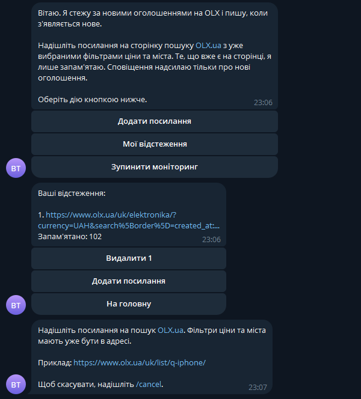

# OLX Monitor Bot

Телеграм-бот стежить за новими оголошеннями на OLX.ua. Ви надсилаєте посилання на пошук із уже вибраними фільтрами ціни та міста, а бот запам'ятовує поточні оголошення і пише лише про нові.




## Можливості

- Команда `/start` і кнопки: «Додати посилання», «Мої відстеження», «Зупинити моніторинг» або «Запустити моніторинг».
- Кожне посилання зберігається в SQLite окремо для вашого облікового запису. На одного користувача можна зберегти до 20 пошуків.
- Під час першого додавання бот лише запам'ятовує те, що вже є на сторінці, і не надсилає старі оголошення.
- Далі перевірка йде у фоні. Нове оголошення приходить повідомленням із фото, ціною, містом і датою та кнопкою «Відкрити оголошення».
- Моніторинг можна зупинити і запустити знову, не видаляючи збережені посилання.
- Якщо за запитом нічого немає, OLX інколи показує чужі рекомендовані оголошення. Бот їх не бере в історію і не надсилає.

Підходить адреса списку, наприклад `https://www.olx.ua/uk/list/q-iphone/`. Посилання на одне оголошення бот не приймає.

## Стек технологій

- Python 3
- aiogram 3
- Playwright
- playwright-stealth
- BeautifulSoup4
- SQLite

Сторінку пошуку відкриває фоновий браузер: OLX віддає список через CloudFront і відповідає кодом 403 на звичайний HTTP-запит. Playwright запускає Chromium без вікна, playwright-stealth прибирає ознаки автоматизації, а BeautifulSoup4 розбирає картки оголошень. Історія пошуків і вже побачених лотів лежить у файлі SQLite. Фото з CDN за потреби завантажує `aiohttp`, якщо Telegram не може взяти картинку за прямим посиланням.

## Запуск

Потрібні Python 3.11 або новіший і токен бота від [@BotFather](https://t.me/BotFather).

1. Клонуйте репозиторій і перейдіть у його теку:

```powershell
git clone https://github.com/bitforge-py/olx-telegram-monitor.git
cd olx-telegram-monitor
```

2. Створіть і активуйте віртуальне оточення:

```powershell
python -m venv .venv
.\.venv\Scripts\Activate.ps1
```

На Linux або macOS активація інша: `source .venv/bin/activate`.

3. Встановіть залежності:

```powershell
pip install -r requirements.txt
```

4. Встановіть браузер для Playwright:

```powershell
python -m playwright install chromium
```

Якщо на комп'ютері вже є Google Chrome, бот спробує відкрити його у фоні. Якщо Chrome немає, використовується щойно встановлений Chromium.

5. Створіть файл налаштувань зі зразка:

```powershell
Copy-Item .env.example .env
```

На Linux або macOS: `cp .env.example .env`.

6. Відкрийте `.env` і вкажіть токен:

```text
BOT_TOKEN=123456789:токен_від_BotFather
CHECK_INTERVAL_SECONDS=300
```

`CHECK_INTERVAL_SECONDS` - пауза між перевірками всіх збережених посилань. Значення за замовчуванням - 300 секунд (5 хвилин). Менше ніж 30 секунд бот не прийме: часті запити з однієї адреси OLX може тимчасово відхилити.

Файл `.env` не входить до репозиторію. У коміт потрапляє лише `.env.example` без справжнього токена.

7. Запустіть бота:

```powershell
python main.py
```

Зупинка: `Ctrl+C` у тому ж вікні термінала. Окремого вікна браузера немає. Для постійної роботи на сервері підійдуть `screen` або `tmux`.

## Як користуватися

1. Напишіть боту `/start`.
2. На OLX.ua відкрийте пошук, виставте місто, ціну та інші фільтри.
3. Скопіюйте адресу сторінки зі списком оголошень і надішліть її боту. Кнопка «Додати посилання» підкаже формат, але вставити адресу можна і одразу.
4. Дочекайтеся відповіді, скільки поточних оголошень запам'ятано. Ці оголошення в чат не приходять.
5. Коли на першій сторінці пошуку з'явиться нове оголошення, бот надішле його вам.
6. «Мої відстеження» показує збережені адреси і дає їх видалити.
7. «Зупинити моніторинг» вимикає перевірки, доки ви знову не натиснете «Запустити моніторинг».

Бот працює в приватному чаті. Щоб скасувати введення посилання, надішліть `/cancel`.

## База даних

Файл `olx_monitor.db` створюється сам під час першого запуску. Шлях можна змінити змінною `DB_PATH` у `.env`.

- `user_settings` - чи увімкнений моніторинг для користувача.
- `watches` - збережені посилання.
- `seen_ads` - історія побачених оголошень: id, адреса, назва, ціна, місто і дата, фото.

Повторно те саме оголошення не надсилається, якщо його id або адреса вже є в `seen_ads` для цього користувача.

## Структура проєкту

- `main.py` - запуск бота і фоновий цикл перевірки.
- `config.py` - читання `.env`.
- `database.py` - SQLite через `aiosqlite`.
- `parser.py` - відкриття сторінки OLX і розбір карток.
- `handlers.py` - команди, кнопки і текст повідомлень.
- `requirements.txt` - залежності.
- `.env.example` - зразок налаштувань без секретів.

## Якщо оголошення не знаходяться

Верстка OLX інколи змінюється. Картка зараз читається за ознаками `data-cy="l-card"`, `data-testid="ad-price"`, `data-testid="location-date"` і `data-testid="listing-grid"`. Якщо в логах з'являється повідомлення, що картки не знайдені, відкрийте сторінку пошуку в браузері, подивіться актуальні атрибути картки і оновіть селектори в `parser.py`.

Перевіряється перша сторінка кожного збереженого посилання. Якщо між перевірками з'явиться більше оголошень, ніж вміщує перша сторінка, частина може лишитися поза розсилкою. Інтервал у 5 хвилин для звичайного пошуку цього зазвичай вистачає.
